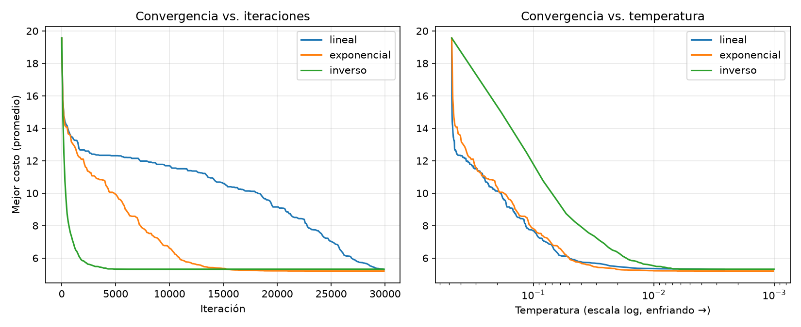
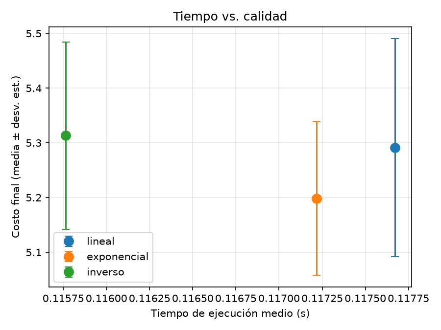

# Ejercicios de Algoritmia

## Repositorio
URL del repositorio:
https://github.com/DIegoRdz444/algoritmia_ejercicios/new/main?filename=README.md

## Video Demo
URL del video:
PEGAR AQUI EL ENLACE DEL VIDEO

---

# Ejercicio 1: Aceleración Paralela

## Descripción

Se ejecutó el algoritmo `estimate_pi` utilizando 1, 2, 4 y 8 procesos para analizar el impacto del paralelismo en el tiempo de ejecución.

## Análisis

La aceleración obtenida no fue perfectamente lineal. Aunque aumentar el número de procesos puede reducir el tiempo de ejecución, también introduce sobrecostos asociados a la creación de procesos, sincronización y comunicación entre ellos.

Además, existen partes del algoritmo que siguen ejecutándose de forma secuencial, lo que limita la aceleración máxima posible. Este comportamiento es consistente con la Ley de Amdahl.

---

# Ejercicio 2: Mochila Voraz

## Descripción

Se compararon dos estrategias para resolver el problema de la mochila:

- Prioridad por valor/peso.
- Prioridad por menor peso.

Objetos utilizados:

| Objeto | Peso | Valor |
|---------|---------|---------|
| A | 1 | 1 |
| B | 2 | 2 |
| C | 4 | 10 |

Capacidad de la mochila: 5

## Resultados

### Método valor/peso

- Objetos seleccionados: A y C
- Capacidad utilizada: 5
- Valor total: 11

### Método menor peso

- Objetos seleccionados: A y B
- Capacidad utilizada: 3
- Valor total: 3

## Análisis

El criterio basado en valor/peso obtuvo una solución mucho mejor que el criterio basado únicamente en el peso.

Seleccionar primero los objetos más ligeros puede desperdiciar capacidad disponible y producir soluciones con menor beneficio total.

---

# Ejercicio 3: Búsqueda Local (2-opt)

## Descripción

Se implementó la heurística 2-opt para mejorar soluciones del Problema del Agente Viajero (TSP).

Se compararon dos soluciones iniciales:

- Ruta aleatoria.
- Vecino Más Cercano.

## Resultados

La solución inicial generada mediante Vecino Más Cercano necesitó muchas menos mejoras para alcanzar un óptimo local que una solución completamente aleatoria.

Sin embargo, ambos métodos alcanzaron costos finales muy similares.

## Análisis

Vecino Más Cercano produce rutas iniciales de mejor calidad, por lo que 2-opt requiere menos intercambios para optimizarlas.

Aunque ambos enfoques alcanzan soluciones finales parecidas, iniciar con Vecino Más Cercano reduce considerablemente el esfuerzo de búsqueda.

---

# Ejercicio 4: Recocido Simulado

## Descripción

Se implementó Recocido Simulado usando movimientos 2-opt para el TSP.

Se compararon tres esquemas de enfriamiento:

- Lineal
- Exponencial
- Inverso

## Resultados

Las gráficas muestran la evolución del costo conforme avanzan las iteraciones y disminuye la temperatura.

También se comparó el tiempo de ejecución contra la calidad de la solución final.

## Análisis

El enfriamiento exponencial obtuvo los mejores resultados promedio.

El esquema inverso converge rápidamente al inicio, mientras que el lineal realiza mejoras más graduales.

Los tiempos de ejecución fueron muy similares porque todos los métodos utilizaron la misma cantidad de iteraciones.

---

# Ejercicio 5: Aproximación mediante MST

## Descripción

Se generaron 100 instancias aleatorias de 9 ciudades.

Se compararon los siguientes métodos:

- MST puro
- MST + 2-opt
- 2-opt con inicio aleatorio
- 2-opt con Vecino Más Cercano
- Recocido Simulado

## Resultados

La mayoría de las razones de aproximación observadas permanecieron muy por debajo del límite teórico de 2.

Los resultados muestran que MST puro produce soluciones más costosas y que la aplicación de 2-opt mejora significativamente la calidad de la ruta obtenida.

## Análisis

La razón de aproximación observada se mantuvo lejos del peor caso teórico.

Aplicar 2-opt sobre el recorrido generado por MST permite reducir el costo del tour y obtener soluciones comparables con las alcanzadas mediante búsqueda local y recocido simulado.

---

# Conclusiones

Los experimentos permitieron comparar diversas técnicas de optimización, búsqueda local y aproximación.

La heurística basada en valor/peso resultó superior en el problema de la mochila.

Para el TSP, el algoritmo Vecino Más Cercano proporcionó mejores puntos de partida para 2-opt, reduciendo el número de mejoras necesarias para converger.

El Recocido Simulado mostró que la elección del esquema de enfriamiento influye directamente en la calidad de la solución.

Finalmente, la aproximación basada en MST generó soluciones cercanas al óptimo y mejoró aún más cuando se complementó con 2-opt.
